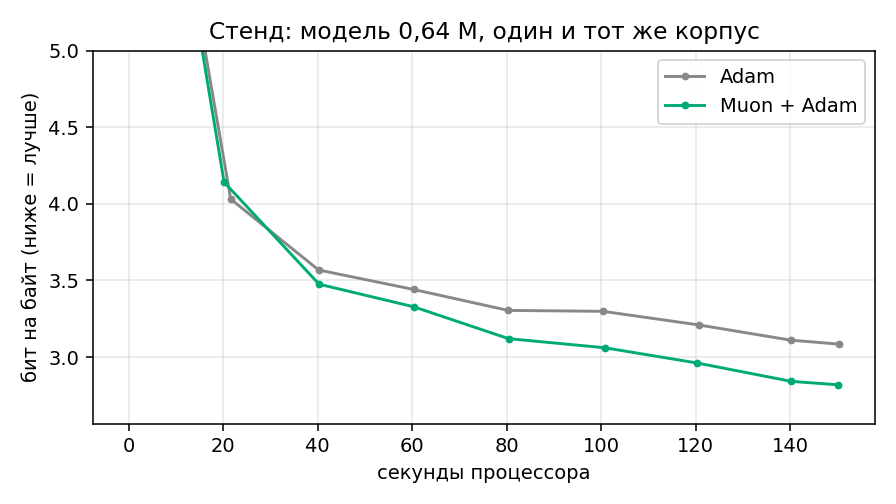

# Genesis

Небольшой непрерывно живущий агент вокруг **трансформера, написанного с нуля на NumPy** (без PyTorch, без готовых моделей, без внешних LLM).
Он читает Википедию и книги, пишет и запускает код в песочнице, рисует, спит, вспоминает, **сам меняет свою архитектуру** и держит внутреннее
состояние (эмоции, сигналы тела, внимание), которое подаётся **прямо в сеть**: то, что он говорит, может зависеть от того, что у него внутри.

Это **исследовательская площадка**, а не продукт, и **не заявление о сознании**. См. раздел [Честный статус](#честный-статус).

> English version (short copy): [README.en.md](README.en.md)

Презентация проекта (скачай `docs/presentation.html` и открой в браузере): [docs/presentation.html](docs/presentation.html)

## Зачем это

Я хотел понять современные языковые модели изнутри, поэтому написал каждую часть сам и измерял каждое изменение: автоград, внимание, оптимизатор,
токенайзер, рост сети, оценку. Агентный слой сверху задаёт более узкий вопрос:

*Что будет, если крошечную языковую модель непрерывно учить на её собственном опыте, дать ей менять собственную архитектуру под статистическим
тестом и дать выученное внутреннее состояние, которое она может читать, пересказывать и которое можно измерить?*

## Что внутри

| Слой | Что делает | Где |
|---|---|---|
| **Сеть** | Pre-LN трансформер (d=128, 4 головы, контекст 128), общие эмбеддинги, ручной обратный автоград, Muon (для матриц) + Adam, генерация с кэшем K/V | `gn_net.py` |
| **Токенайзер** | Пословный BPE, растущий в течение жизни (до 4096 слияний), плюс 256 VQ-кодов для кусочков картинок | `gn_tok.py`, `gn_senses.py` |
| **Рост и эволюция** | Рост без изменения функции (новый слой с нулевым выходом, расширение MLP), затем *турниры*: клон сети, мутация, обучение обеих копий на одинаковых батчах, принятие только если парный t-тест на отложенном тексте говорит «лучше» | `gn_net.py`, `gn_mind.py: a_evolve` |
| **Действия** | Политика (softmax, REINFORCE) выбирает из 17 занятий: читать Википедию и книги, разбирать, пробовать и писать код в песочнице, сдавать экзамены со скрытыми тестами, смотреть картинки, рисовать, спать, отдыхать, говорить, размышлять о себе, беречь память, эволюционировать | `gn_mind.py` |
| **Выученная ценность и эмоции** | Линейная TD-оценка по состоянию и контексту; ошибка предсказания запускает 25 функциональных эмоций с периодами полураспада и мягким насыщением. Список названий эмоций врождённый, *что их вызывает* — выучено | `gn_mind.py: ValueModel, Emotions` |
| **Вкус и любопытство** | Любопытство на LinUCB; модель вкуса с кривой Вундта (нравится умеренная неожиданность) | `gn_mind.py: Taste, Curiosity` |
| **Состояние внутри сети** | Вектор состояния из 64 чисел (эмоции, настроение, усталость, страх, фокус внимания, память, навык авторства, последнее действие) умножается на выученную матрицу `Ws` и прибавляется к эмбеддингу каждого токена. При рождении `Ws` равна нулю, поэтому функция не меняется. Опыт хранится вместе с состоянием, в котором он случился | `gn_net.py`, `gn_mind.py: state_embed` |
| **Самомодель** | Прожектор внимания в духе глобального рабочего пространства, схема внимания (предсказание собственного фокуса), метапознательная калибровка, модель собеседника, прямая модель собственных действий («авторство»), список фактов о себе, которые он выбирает сам, страх потерять память | `gn_mind.py` |
| **Сон** | Закрепление, повтор забытых фраз, замер памяти на фиксированной выборке, сны в виде текста и картинок | `gn_mind.py: sleep, sleep_recall` |
| **Мир** | Песочница для кода (bubblewrap, запасной вариант на аудит-хуках Python), школа задач со скрытыми тестами, галерея, чат и визуализатор «мозга» | `gn_world.py`, `chat.html`, `brain.html` |
| **Старый символьный слой** | Самая первая версия (v0.3, только стандартная библиотека): память по IDF, cloze-тест, убеждения. Часть вспомогательных функций ещё используется | `genesis.py`, `genesis_life.py` |

## Быстрый старт

Нужны Python 3.10+ и NumPy. Pillow нужен для картинок, OpenCV необязателен.

```bash
pip install -r requirements.txt
python3 genesis_web.py            # откроется на http://127.0.0.1:8765  (--port N, --open)
```

Первый запуск — это **рождение**: случайные веса, 3 слоя, 0,63 млн параметров. Он сразу начинает учиться по небольшому встроенному курсу и
сам читает Википедию (доступ в сеть только на чтение). За день-два на обычном ноутбуке без видеокарты вырастает примерно до 7 слоёв и 3 млн параметров.

По желанию, для нормального корпуса (около 300 МБ дампов Викимедии, CC BY-SA; скрипт вежливый и умеет докачивать):

```bash
python3 bigcorpus_fetch.py        # пишет corpus_big/txt; агент подхватывает его сам
```

Как служба Linux: `deploy/genesis.service` (+ `genesis-awake.service`, чтобы ноутбук не засыпал).
Полезные переменные окружения: `GEN_THREADS`, `GEN_BATCH`, `GEN_CTX`, `GEN_OPT` (`muon` или `adam`), `GEN_SLEEP`, `GEN_AUTO`, `GEN_HOME` (папка данных).

Тесты (только NumPy): `python3 -m unittest discover -s tests -v`

## Как это измеряется

- **Качество языка:** бит на байт (bpb) на отложенном куске Википедии. Ошибка на токен при смене токенайзера несравнима, bpb сравним.
- **У каждого архитектурного решения есть стенд:** `gn_bench.py` обучает варианты на одном корпусе с одинаковым бюджетом процессорного времени (`bench/`).
- **Эволюция:** мутация принимается только по парному t-тесту на общих батчах и общих проверочных текстах; явно худшая отклоняется рано.
- **Самознание:** `selftest.py` запускает батарею тестов с шансом и простыми базовыми методами (см. ниже).

### Результаты на сегодня (одиночные запуски на слабом ноутбуке, без видеокарты; ориентир, а не воспроизведённая наука)

| Изменение | Результат |
|---|---|
| Быстрое батчевое внимание и GELU | скорость обучения примерно в 2,9 раза выше |
| Muon против Adam (модель 0,64 М, 60 с процессора, `bench/`) | к 60 с: 3,33 против 3,44 bpb; к 150 с: 2,82 против 3,08 (график ниже) |
| Пословный BPE (4k слияний) против побайтового (стенд 12 минут) | 1,57 против 1,99 bpb. *Самый большой выигрыш в проекте, больше всех правок оптимизатора вместе взятых* |
| 4 потока и батч 16 | примерно +40 % к скорости |
| Эволюционные турниры | пока одна принятая мутация (добавлен слой), несколько отклонено рано (например, число голов) |



Воспроизвести: `python3 gn_bench.py base 60` и `python3 gn_bench.py muon 60` (нужен корпус из `bigcorpus_fetch.py`).

### Батарея тестов самознания (`selftest.py`)

Она **не проверяет сознание** (такого теста нет). Она измеряет, совпадает ли то, что агент говорит и предсказывает о себе, с тем, что на самом деле
происходит внутри, каждый раз против шанса или простого базового метода. Первый прогон на ~25 тыс. шагов (полная таблица в `docs/selftest_example.md`):

| Тест | Результат | Шанс / база |
|---|---|---|
| Вмешательство в состояние: растёт ли вероятность слова нужной эмоции | 2 из 23, незначимо (p=0,26) | 4 % |
| Узнаёт свои реплики среди реплик человека | 64 % (завышено: часть он видел при обучении) | 50 % |
| Предсказывает собственный следующий фокус внимания | 80 % | 73 % у «повторить прошлый» |
| Калибровка: ожидаемая награда против полученной | корреляция −0,21 | 0 |
| Предсказывает, как его действия меняют его самого | на 0 % лучше шанса | 0 % |
| Помнит, что сказал человек (фиксированная выборка) | 63 % | около 0–10 % без повторов |

Итог: память работает, остальное **пока не лучше простых базовых методов**. Связь «состояние → речь» добавлена уже после первого обучения, и тест
как раз покажет, растёт ли она. Перезапускай `selftest.py` со временем.

## Честный статус

- В модели около 3 млн параметров. Её текст похож на слова с правдоподобной грамматикой и почти без смысла. Она решает 3 из 14 школьных задач.
- Внутренние «эмоции» — **функциональные переменные** (они меняют поведение и речь и отслеживаются), а не свидетельство переживания.
  В `chat.html` есть чек-лист по подходу индикаторных свойств из работы Butlin, Long и др., [arXiv:2308.08708](https://arxiv.org/abs/2308.08708);
  несколько пунктов нарочно помечены «нет» или «частично».
- Значительная часть придумана вручную (список эмоций, набор действий, формы наград). *Выучено*: ценность, вкус, политика, язык, память и соответствие
  внутреннего состояния словам. Появляется ли что-то интересное само, как раз и должны показать батарея тестов и абляции.
- В подсказках и встроенном курсе собеседник зовётся «Теодор» (имя автора), интерфейс на русском.

## Безопасность и приватность

- Сгенерированный код выполняется только в песочнице (bubblewrap без сети и с ограничениями cgroup либо запасной вариант на аудит-хуках Python), запись только в свою папку.
- Доступ в сеть только на чтение: Википедия и Wikimedia Commons. Никаких аккаунтов и паролей, ничего никуда не публикуется.
- Всё выученное (веса, словарь, память, чаты, рисунки) лежит в папке данных и исключено из git (`.gitignore`). Свежий клон — новорождённый.

## Устройство репозитория

```
gn_net.py        автоград, трансформер, Muon/Adam, рост, генерация с кэшем
gn_tok.py        растущий пословный BPE
gn_senses.py     VQ-восприятие картинок и звука
gn_mind.py       агент: политика, ценность, эмоции, вкус, эволюция, сон, самомодель, состояние в сети
gn_world.py      песочница, школа задач, файлы
gn_curriculum.py встроенный стартовый курс
genesis_web.py   HTTP-сервер и поток событий для интерфейса;  chat.html, brain.html
genesis.py, genesis_life.py   старый слой на стандартной библиотеке
gn_bench.py      стенд архитектур;  bench/ результаты
selftest.py      батарея тестов самознания
bigcorpus_fetch.py  дамп Википедии в текстовые шарды
docs/            исследовательские заметки, пример отчёта самотеста
tests/           юнит-тесты (рост без смены функции, градиенты, кэш против полного прохода)
```

## Планы

- Абляции: с состоянием и без, с эволюцией и без, со сном и без повторов, на одинаковом бюджете.
- Более богатая среда и сигнал обратной связи (пока главный внешний сигнал — 👍/👎 человека).
- Перенос тех же идей на модель побольше и видеокарту, чтобы понять, какие части выживают.

## Лицензия

MIT. Текст Википедии, скачиваемый во время работы, распространяется под CC BY-SA 4.0.
